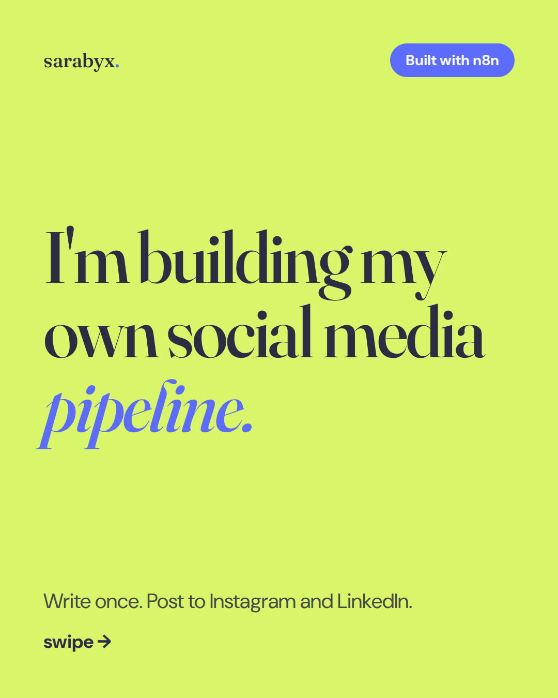
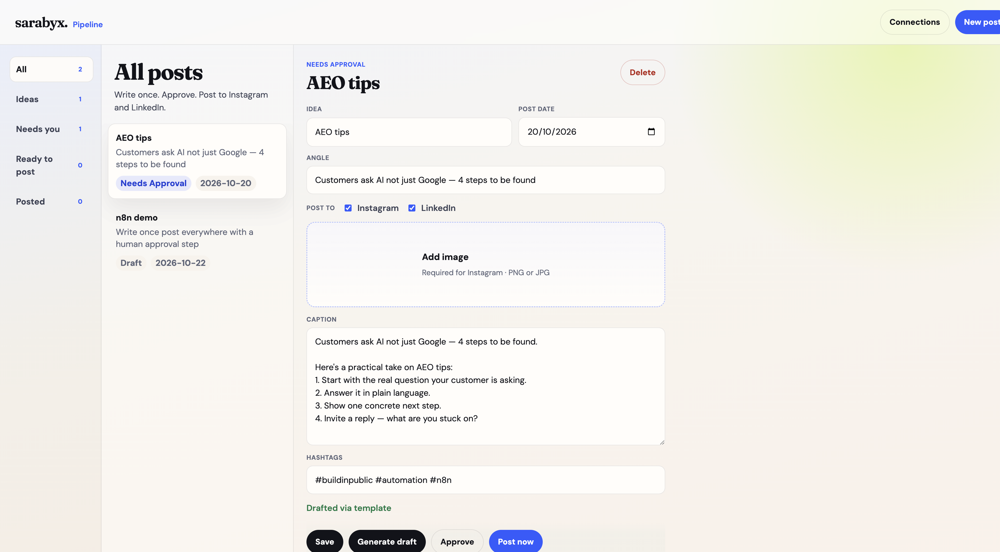
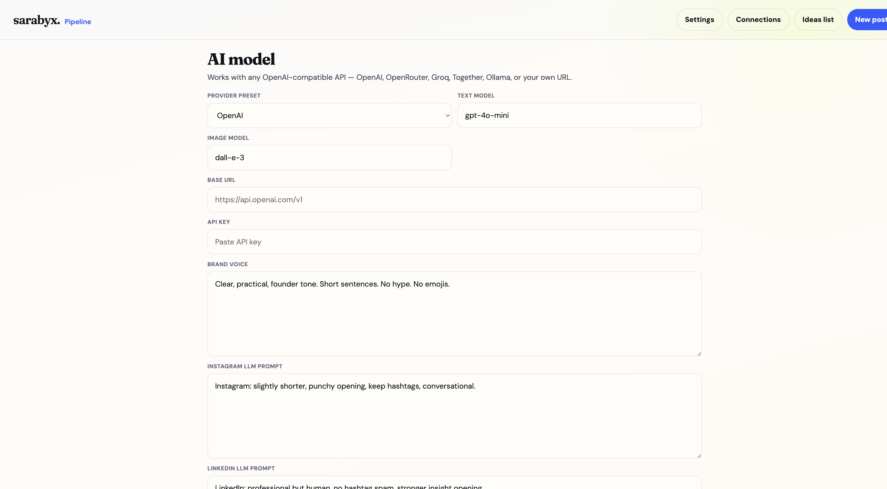
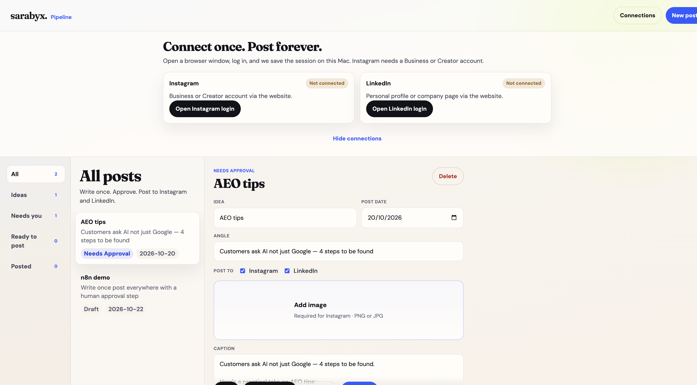

<p align="center">
  
</p>

# sarabyx Pipeline

**Write once. Approve. Post to Instagram and LinkedIn — from your own Mac.**

A local web app that turns ideas into drafts with any OpenAI-compatible model, waits for your approval, then posts in **Google Chrome**. No Playwright. No cloud of your passwords. No API keys bundled in this repo.

> **Privacy:** This repository ships empty. Your API key, Chrome logins, and posts stay on your machine under `data/` and `sheet/` (gitignored).

---

## Screenshots

### Pipeline UI
Ideas → draft → approve → post, all in one local app.



### Settings — add *your* API key
Works with OpenAI, OpenRouter, Groq, Together, Ollama, or any OpenAI-compatible URL.



### Connections — Pipeline Chrome
Enable Chrome control, sign into Instagram & LinkedIn once, then Detect sessions.



---

## Requirements

| Need | Notes |
|------|--------|
| **macOS** | Posting drives Google Chrome via DevTools |
| **Node.js 20+** | [nodejs.org](https://nodejs.org/) |
| **Google Chrome** | Already installed on most Macs |
| **Your API key** | Optional for template drafts; required for AI |

---

## Quick start

```bash
git clone https://github.com/OWNER/REPO.git
cd REPO
./scripts/setup.sh
./scripts/start-ui.sh
```

Open **http://127.0.0.1:3920**

1. **Settings** → paste your API key → **Save** → **Test model**
2. **Connections** → **Enable Chrome control** → open Instagram / LinkedIn → sign in → **Detect sessions**
3. Add ideas → **Generate draft** → **Approve** → **Post now**

Nothing publishes until a post is **Approved** and you click **Post now**.

---

## How it works

```text
Ideas  →  AI draft (+ optional image from comments)
       →  You approve / comment → regenerate
       →  Post now in Pipeline Chrome (IG + LI)
       →  Mark as posted or auto-move to Posted
```

- **Per-platform LLM prompts** — customize Instagram vs LinkedIn tone (Settings or per post)
- **Regenerate with comments** — e.g. “shorter” or “generate an image of …”
- **Post all approved** — publish the Approved queue in sequence
- **Mark as posted** — confirm something already live and clear it from the active list

---

## AI providers

| Preset | Base URL example | Model example |
|--------|------------------|---------------|
| OpenAI | `https://api.openai.com/v1` | `gpt-4o-mini` |
| OpenRouter | `https://openrouter.ai/api/v1` | `openai/gpt-4o-mini` |
| Groq | `https://api.groq.com/openai/v1` | `llama-3.3-70b-versatile` |
| Ollama (local) | `http://localhost:11434/v1` | `llama3.2` |
| Custom | your `/v1` endpoint | your model |

Image generation (from feedback like “generate image”) uses the **Image model** field (default `dall-e-3`) on providers that support `/images/generations`.

---

## What is *not* in this repo

These are created locally after setup and **never** committed:

| Path | Contains |
|------|----------|
| `.env` | Optional local overrides |
| `data/settings.json` | Your API key |
| `data/chrome-profile/` | Pipeline Chrome login cookies |
| `data/connections.json` | Connection flags |
| `sheet/content.csv` | Your posts |
| `browser/media/*` | Uploaded images |

Starter templates only: `.env.example`, `sheet/content.example.csv`, `data/connections.example.json`.

---

## Scripts

| Command | Purpose |
|---------|---------|
| `./scripts/setup.sh` | Install deps, create empty local files |
| `./scripts/start-ui.sh` | Run the app on port `3920` |
| `./scripts/pack-release.sh` | Build a clean zip (no secrets) for sharing |
| `npm start` | Same as `start-ui.sh` |

---

## Optional n8n

The UI alone is enough for the human workflow.  
`workflows/` + `docker-compose.yml` are optional if you want scheduled draft/publish later.

---

## Troubleshooting

| Issue | Fix |
|-------|-----|
| Post now disabled | Approve the post first |
| Instagram / LinkedIn “not signed in” | Open them in **Pipeline Chrome**, sign in, Detect sessions |
| Double tabs on Open | Update to latest — Open reuses one tab per site |
| Image gen fails | Your provider may not support image models — upload an image instead |
| Port in use | Stop the old server or set `POSTER_PORT` in `.env` |

---

## License

Use freely for your own posting. Bring your own API key and accounts.

---

<p align="center">
  <strong>Write once. Post to Instagram and LinkedIn.</strong>
</p>
